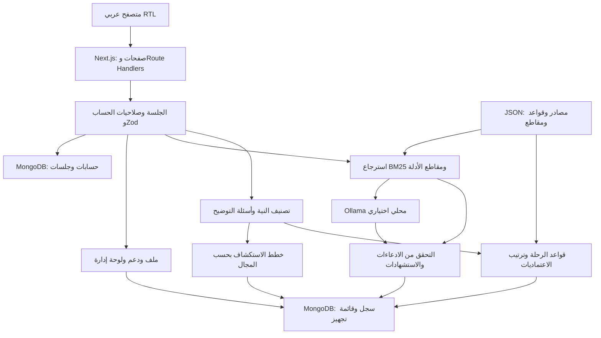
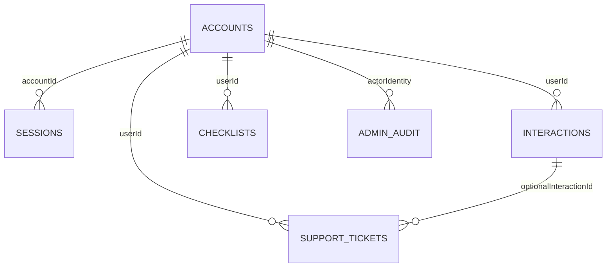

# تصميم النظام والبيانات وواجهات API

## البنية الحالية

التطبيق واحد؛ الطبقات ليست microservices. `app/` يعالج HTTP والصفحات، `components/` يعالج العرض، `lib/` يحوي منطق المجال، و`data/` معرفة ثابتة قابلة للمراجعة. MongoDB إلزامي للمصادقة والحفظ؛ Ollama وحده اختياري. لا يستدعي المتصفح النموذج مباشرة، ولا تُستخدم بيانات من حساب المطوّر عند تنزيل الكود.

### تدفق طلب كامل

1. تُفحص الجلسة المخزنة والحساب وحالته ونسخة الجلسات.
2. يتحقق Zod من المدخل، وتفصل النية بين المشروع والسؤال والخدمة غير المدعومة.
3. حقول المستخدم الصريحة والاختيارات لها أولوية؛ النواقص تُطلب بدل التخمين.
4. الحالة المغطاة تنتقل إلى قواعد الرحلة؛ الأنشطة الأخرى إلى خطة استكشاف عامة.
5. السؤال يسترجع مقاطع مناسبة؛ العبارة الواضحة قد تُجاب اقتباسيًا، والسؤال التفسيري يمكن أن يستخدم Ollama.
6. تُراجع معرفات الأدلة وتداخل الادعاءات؛ الروابط غير الموجودة تُرفض. هذا ليس برهانًا دلاليًا كاملًا على صحة كل جواب.
7. يحفظ `jsonWithHistory` النتيجة بمفتاح تدفق واحد؛ فشل الحفظ يُرجع خطأ بدل نجاح وهمي.

## MongoDB

المخطط التالي منطقي؛ MongoDB لا يفرض foreign keys. علاقة `userId` تستخدم هوية الحساب (username أو email) الحالية؛ `accountId` في الجلسات نص ObjectId.

| المجموعة | الحقول المهمة | الفهارس / الملاحظات |
|---|---|---|
| `accounts` | email, username?, name, phone, passwordHash, role, status, sessionVersion, theme, protectedAdmin?, resetHash?, resetExpires?, createdAt | email فريد؛ username فريد sparse عند التهيئة؛ الاستعادة داخل الحساب |
| `sessions` | tokenHash, accountId, userId, createdAt, expiresAt | tokenHash فريد؛ TTL على expiresAt؛ التحقق من الانتهاء فوري في الكود ولا ينتظر TTL |
| `interactions` | userId, requestKey, type, input, response, createdAt, updatedAt | userId+createdAt؛ userId+requestKey فريد جزئي للحقول النصية؛ upsert وتحديث السجل نفسه |
| `checklists` | userId, key, knowledgeVersion, checkedIds, updatedAt | userId+key فريد؛ المفتاح مرتبط بالحالة ونسخة المعرفة |
| `support_tickets` | userId, subject, message, category, context?, interactionId?, contact, status, replies[], createdAt | userId+createdAt؛ ارتباط الطلب يُتحقق أنه يخص صاحب الرسالة |
| `admin_audit` | actor, action, targetId, status, details, createdAt | يوثق attempted ثم completed؛ ليس سجلًا غير قابل للتعديل تشفيريًا |

`db:setup` ينشئ حساب العرض والفهارس الأساسية. بعض الفهارس تُنشأ عند أول استخدام أيضًا. حذف المستخدم يلغي جلساته ويحذف سجله وقوائمه ورسائل الدعم، مع بقاء سجل الإدارة. الحذف متعدد المجموعات ليس transaction؛ حالة deleted تمنع الدخول حتى إن حدث فشل جزئي.

النص الأصلي يُحجب فيه بعض أنماط الأرقام قبل الحفظ؛ الاستجابة المخزنة ليست خاضعة لتنقيح شامل للخصوصية. لا ينبغي إدخال أرقام وطنية أو وثائق حساسة في صندوق الطلب.

## API

JSON يدخل ويخرج؛ المراجع الدقيقة: `lib/schemas.ts` و`lib/contracts.ts` و`lib/admin-contracts.ts` ومخططات المسارات نفسها. الجلسة cookie `lifeevent_session` من نوع HttpOnly. جميع APIs غير auth/status محمية في `proxy.ts`، ثم تُفحص الملكية أو صلاحية المدير بحسب المسار.

| المسار | الطريقة | المدخل الأساسي | الصلاحية والنتيجة |
|---|---|---|---|
| `/api/auth/register` | POST | name, email, phone, password | عام؛ إنشاء user وجلسة؛ لا يقبل ترقية الدور من المدخل |
| `/api/auth/login` | POST | username, password؛ username يقبل البريد أيضًا | عام؛ فحص الحساب وجلسة وتحويل مناسب للدور |
| `/api/auth/logout` | POST | cookie | إنهاء الجلسة المخزنة ومسح cookie |
| `/api/auth/forgot-password` | POST | email | عام؛ رابط dev مؤقت فقط، دون بريد إنتاجي |
| `/api/auth/reset-password` | POST | token, password | عام؛ رمز ساري ولمرة واحدة، وإبطال جلسات قديمة |
| `/api/status` | GET | — | عام؛ حالة Ollama الحقيقية وليس فحص MongoDB |
| `/api/intake` | POST | goal, slots? | حساب؛ نية وحقول وسؤال تالٍ أو توجيه |
| `/api/journey` | POST | slots | حساب؛ رحلة وشروط ومستندات وأدلة |
| `/api/explore` | POST | goal | حساب؛ ملف المشروع وخطة استكشاف |
| `/api/answer` | POST | question, slots?, procedureId? | حساب؛ answered أو insufficient_evidence ومقاطع |
| `/api/sources` | GET | — | حساب؛ المصادر والمقاطع المسموح عرضها |
| `/api/history` | GET | — | حساب؛ أحدث سجلات صاحب الجلسة فقط |
| `/api/checklist` | GET / PUT | key؛ أو key, knowledgeVersion, checkedIds | حساب؛ قراءة أو حفظ قائمته |
| `/api/profile` | GET / PATCH | —؛ أو name, phone | حساب؛ ملف وإحصاءات أو تحديث بيانات مسموحة |
| `/api/preferences` | GET / PATCH | —؛ أو theme | حساب؛ المظهر light/dark/system |
| `/api/support` | GET / POST | subject, message, category, context?, interactionId? | حساب؛ رسائله أو إنشاء رسالة |
| `/api/admin` | GET | view والبحث والصفحة حسب المسار | admin؛ مؤشرات أو قوائم مستخدمين/دعم/سجل |
| `/api/admin` | PATCH | id, status, reply? | admin؛ تحديث تذكرة ورد وسجل إدارة |
| `/api/admin/users` | POST | id, action, role? أو تأكيد حذف | admin؛ تفعيل/تعليق/حظر/دور/إلغاء جلسات/حذف |

واجهات الطلب تستخدم `x-request-id` بصيغة UUID لربط مراحل التدفق بالسجل نفسه. دون هذا الرأس يوجد مفتاح مشتق من نوع الطلب والنص؛ إعادة نفس النوع والنص عبر استدعاء مباشر تُحدّث نفس السجل. التفاصيل في [السجل](request-history.md).

أخطاء شائعة: 400 مدخل غير صالح، 401 غياب جلسة، 403 صلاحية مدير مفقودة، 404 سجل غير موجود، 409 تعارض، 422 نطاق رحلة غير مدعوم، 429 معدل تجاوز الحد، 503 تعذّر تخزين. لا يطبق كل مسار كل هذه الحالات. شكل الخطأ عبر `apiError` في `lib/schemas.ts`.

## الصيانة

إضافة إجراء تبدأ بالمصدر والمقطع وشروط الحالة والاعتماديات، ثم اختبار الفرع، ومراجعة بشرية قبل النشر في production. القواعد لا تأتي من جواب النموذج. توسعة البيانات والبحث مستقبلاً تتطلب قياسات حجم وأداء؛ هذه الوثيقة لا تدّعي تنفيذ بحث متجهي أو نشر موزع.
