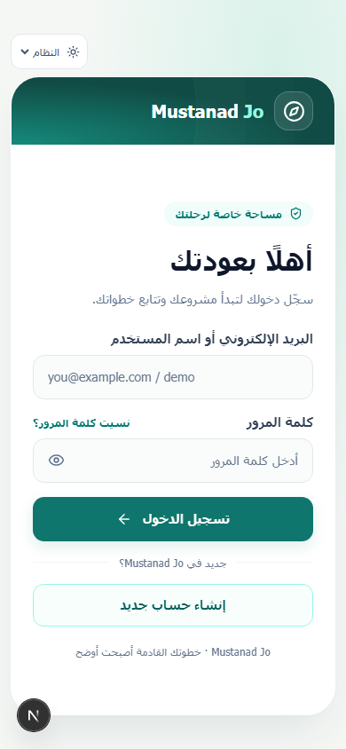
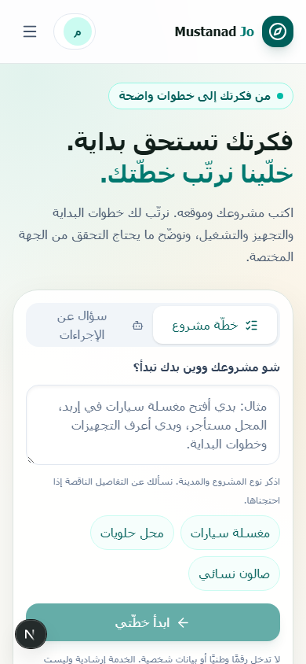

# مراجعة تجربة المستخدم والمظهر — 10 أكتوبر 2026

التقييم: التصميم متماسك وله هوية واضحة، لكن قبل هذه الجولة كانت مقدمة الهاتف تؤخر الوصول للإجراء الأساسي، والسجل لا يتيح قراءة تفاصيل النتائج، وبعض ألوان الوضع الليلي ضعيفة. عولجت هذه النقاط. الموقع صار أوضح وأسهل للاستخدام في السيناريوهات التي فُحصت؛ لا تعني هذه المراجعة أنه جاهز للإنتاج على نطاق واسع أو حاصل على شهادة WCAG.

## كيف تم التقييم

محاكاة مستخدم جديد ثم صاحب حساب داخل Edge فعلي، على نسخة Next.js مبنية للإنتاج: الدخول، كتابة فكرة، رؤية الخطة والرحلة، الملف الشخصي، السجل، الدعم، والمصادر. تمت مقارنة الهاتف 390px والكمبيوتر 1440px بالنهاري والليلي، وإضافة فحص 320px للرئيسية والدخول. استُخدم حساب مؤقت في جولة التحقق النهائية ونُظفت بياناته بعدها.

ليست هذه دراسة مع مشاركين حقيقيين. الصور تكشف المظهر والتجاوز الأفقي، والاختبارات التفاعلية تتحقق من سلوك مختار. ليست محاكاة شاملة لقارئ الشاشة أو لكل جهاز ومتصفح.

## المراجع وما تغيّر بسببها

| المبدأ | المشكلة المرصودة | التعديل |
|---|---|---|
| [Nielsen: وضوح حالة النظام والتحكم والرجوع](https://www.nngroup.com/articles/ten-usability-heuristics/) | زر عام باسم «تابع»، مقدمة طويلة، غياب توضيح بعد الإلغاء | أزرار تصف النتيجة، مقدمة أقصر، ورسالة بعد إيقاف الانتظار وإعادة التحكم للمستخدم |
| [Microsoft HAX: توضيح قدرة AI وحدوده والتعافي](https://www.microsoft.com/en-us/haxtoolkit/ai-guidelines/) | اسم Ollama وتفاصيل تشغيلية في تجربة المستخدم، واحتمال فهم الرابط الرسمي كدليل نهائي | نصوص مفهومة، السؤال بجانب جوابه، ومراجعة مصدر/مقطع فعلية قرب الإجابة. لا تُعرض حالة «تمت المراجعة» إلا إذا كانت كل الأدلة مراجعة |
| [WCAG 2.2: Contrast Minimum](https://www.w3.org/WAI/WCAG22/Understanding/contrast-minimum.html) | عناوين صغيرة داخل بانر الرحلة وشريط حالة AI منخفضة التباين ليلًا | تصحيح ألوان النصوص داخل الخلفيات الملونة، وألوان حالة المساعد والنصوص الثانوية، وفحص عينات الأسطح الصلبة بالتباين |
| [WCAG 2.2: Target Size Minimum](https://www.w3.org/WAI/WCAG22/Understanding/target-size-minimum.html) | زر كشف كلمة المرور وأزرار مساعدة صغيرة | تكبير عناصر مختارة إلى 44px لسهولة اللمس. الحد AA هو 24px مع استثناءات؛ 44px هنا هدف عملي للأزرار الأساسية وليس ادعاء فحص كل عنصر |
| [WCAG: Focus Visible](https://www.w3.org/WAI/WCAG22/Understanding/focus-visible.html) | تركيز باهت وغياب تجاوز التنقل | حدود تركيز أوضح نهارًا وليلًا، رابط لتجاوز القائمة إلى المحتوى، وإغلاق القائمة بـEscape وإعادة التركيز للزر |
| [WCAG: Status Messages](https://www.w3.org/WAI/WCAG22/Understanding/status-messages.html) | عدّاد قد يعيد إعلان الحالة كل ثانية | إبقاء رسالة انتظار قابلة للإعلان، وفصل عدّاد الثواني عن الإعلان المتكرر، وإعلان نتيجة الإلغاء |

## تجربة المستخدم بعد التعديل

- الدخول على الهاتف: يبقى شعار الموقع، وتظهر الحقول والأزرار مبكرًا؛ النص الترويجي الموسّع يُعرض على الكمبيوتر.
- بدء الطلب: عنوان ومقدمة أقصر، مثال واضح، ثلاثة اقتراحات، ومساعدة مرتبطة بالمدخل. يتوقف تعديل السؤال أثناء إرساله حتى يبقى الجواب مرتبطًا بالسؤال الذي أُرسل.
- اختيار نوع الطلب: أزرار اختيار ذات `aria-pressed`؛ أزيل توصيف tablist غير المكتمل بدل الإيحاء بسلوك لوحة مفاتيح غير منفذ.
- قراءة الرد: عرض السؤال، والنقاط، والأدلة، والحالة الفعلية لمراجعتها. unknown أو pending لا تتحول إلى reviewed؛ rejected لها حالة منفصلة.
- السجل: بحث ضمن التفاعلات المعروضة، تفاصيل النص المحفوظ والخطوات والوثائق والأدلة، وخيار واضح لطلب جديد بنفس الوصف. قراءة المحفوظ لا تولّد إجابة جديدة. البحث ضمن أحدث التفاعلات المحملة، وليس كامل قاعدة البيانات.
- حالات البداية والفشل: إجراء واضح لبدء أول طلب، إعادة المحاولة عند خطأ السجل، ورسائل تخاطب المستخدم بدل شرح إعداد MongoDB.
- الملف الشخصي: العدد يسمى «تفاعل محفوظ» بدل «طلب»؛ لأن مراحل التوضيح والإجابات قد تسجّل منفصلة.
- المتصفح: عنوان خاص لكل صفحة، وتجاوز القائمة، وتركيز واضح، والحفاظ على اختيار المظهر في الحساب.

## التحقق

نجح 150 اختبارًا في 23 ملفًا، وفحص TypeScript وESLint وبناء الإنتاج. الاختبارات الجديدة تتحقق من أمان حالات المراجعة، قراءة الرد الكامل، استعادة الخطوات والوثائق، وتحمل سجلات قديمة أو غير مكتملة دون عرض JSON داخلي.

نتائج المتصفح النهائية وتفاصيل عينات التباين محفوظة في `ux-review/results.json`. الصور المختارة في المجلد نفسه. سكربت إعادة الفحص: `node --env-file=.env.local scripts/ux-browser-review.mjs`، مع خادم على 3105 أو ضبط `UI_BASE_URL`. يحتاج Edge على Windows، ويستخدم حساب اختبار مؤقتًا ويمسح بياناته في النهاية. اختبار إلغاء الانتظار يستخدم استجابة معلّقة متحكمًا بها في المتصفح حتى يكون ثابتًا؛ ليس قياسًا لإلغاء توليد Ollama داخل الخادم.

- 32 لقطة/حالة عرض، دون تجاوز أفقي أو مدخلات غير مسماة أو أخطاء JavaScript مرصودة.
- 8 سيناريوهات تفاعلية ناجحة: الدخول لملف صاحب الحساب، Escape وإرجاع التركيز، حفظ المظهر، استمراره بعد التنقل، فتح تفاصيل المحفوظ، عدم إنشاء تفاعل عند قراءته، منع تغيير السؤال الجاري، وإلغاء الانتظار مع استعادة التحكم.
- عينات التباين المختارة تجاوزت 4.5:1؛ شملت زر نوع الطلب، نص حالة المساعد، تسميات النموذج، ونصوص بانر الرحلة. القياس لأسطح صلبة مختارة، وليس تدقيق كل ألوان الموقع أو الصور والخلفيات المتدرجة.
- عند 390px وارتفاع 900px كان أسفل زر الدخول عند 656px تقريبًا، وأسفل زر بدء الخطة عند 815px. عند 320px يحتاج بدء الخطة مساحة أعلى قليلًا (856px). لا نفترض أنه ظاهر دون تمرير على كل ارتفاع شاشة.

## ما يجعل النسخة أقوى في المرحلة التالية

1. مراجعة بشرية للمصادر الحكومية: مسؤول لكل مصدر، تاريخ آخر تحقق، واختبارات تمنع نشر محتوى مرفوض. تنبيه المراجعة لا يحل محل التحقق القانوني.
2. تقييم AI مستقل: مجموعة أسئلة عربية لكل قطاع، حالات نقص معلومات وشروط وتناقض ومصدر غير كافٍ؛ قياس صحة الاستشهادات، افتراض الحقائق، ملاءمة الجواب، والكمون على نموذج الجهاز. لا توجد في هذه الجولة نسبة جديدة لدقة النموذج أو مقارنة بين نماذج.
3. جلسات استخدام مع أشخاص من الجمهور الفعلي: قدرة المستخدم على بدء مشروع والوصول للخطوة التالية، وقت المهمة، المواضع التي يتوقف عندها، وملاحظات قارئ الشاشة. هذا يؤكد أو ينقض تقديرنا الهندسي.
4. قياس الأداء على الهاتف والشبكة البطيئة: Lighthouse وقياسات فعلية للتحميل والاستجابة واستقرار التخطيط. لا نستنتج سرعة المستخدمين من لقطات جهاز التطوير.
5. تشغيل الإنتاج: إرسال استعادة كلمة المرور، مراقبة الأعطال والنسخ الاحتياطي واستعادته، ومحدد طلبات مشترك إذا شُغّلت عدة خوادم. هذه أعمال مستقلة عن تحسين الشكل.
